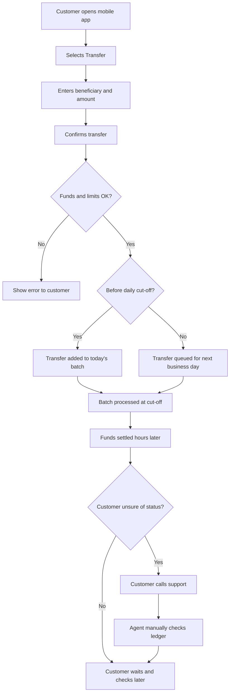
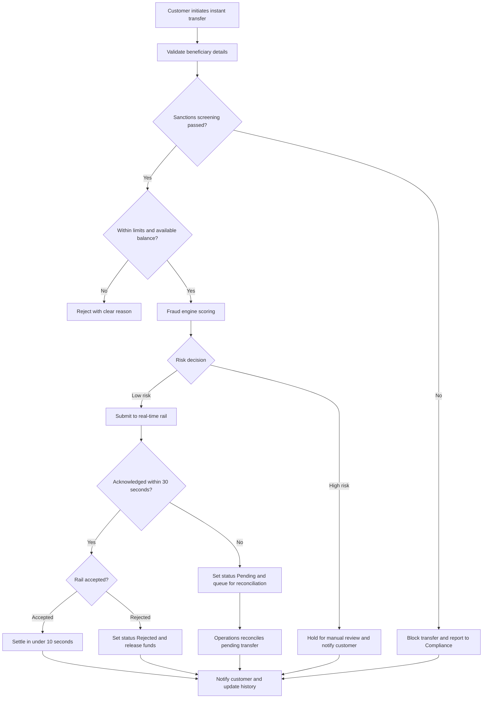
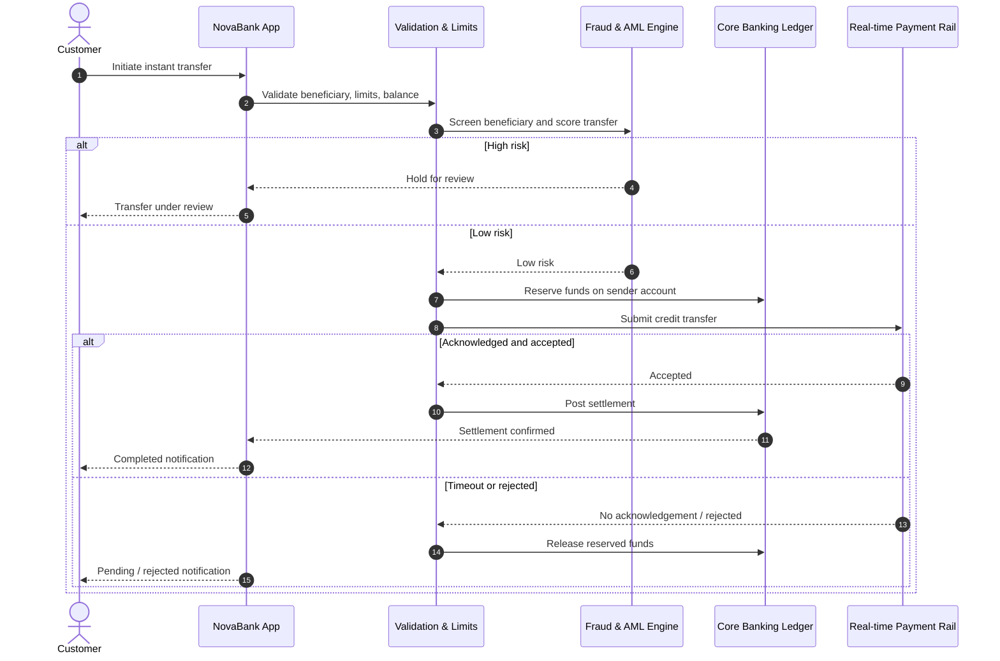

# Process Diagrams — AS-IS and TO-BE
## Instant Transfers — NovaBank Retail Banking

> **Fictitious data, for demonstration purposes only.**

The diagrams below use [Mermaid](https://mermaid.js.org/) and render natively
on GitHub.

---

## 1. AS-IS process — Batched domestic transfer

Today, a customer transfer is queued and processed in batches around fixed
cut-off times, so funds can take hours or up to the next business day to
arrive. Customers often call support to check status.

**Pain points (fictional):**
- Settlement takes hours; transfers after cut-off wait until the next business day.
- No reliable real-time status; customers call support ("where is my transfer?").
- Manual batch exceptions add operational effort.

---

## 2. TO-BE process — Instant Transfer

The target process executes the transfer in real time, with inline validation,
fraud screening and notifications, 24/7.

**Improvements over AS-IS:**
- Real-time settlement (target: < 10 s for 95% of transfers), 24/7.
- Inline validation, sanctions screening and fraud scoring before settlement.
- Proactive notifications reduce "where is my transfer?" support contacts.
- Automated reconciliation of pending transfers; only exceptions reach agents.

---

## 3. TO-BE sequence diagram — Off-us instant transfer

The sequence diagram shows the interaction between the customer, NovaBank and
the external real-time rail for an off-us transfer.

> All process names and figures are fictional and for demonstration purposes only.
