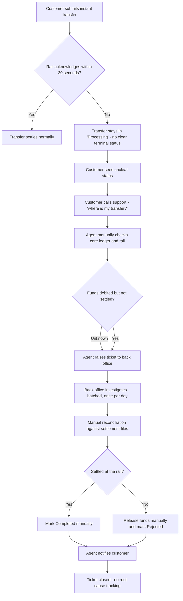
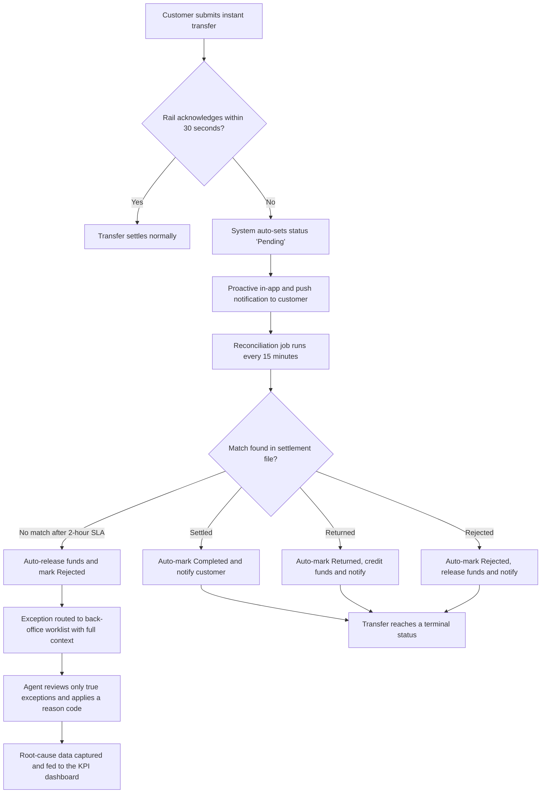

# AS-IS / TO-BE Process Analysis
## Exception handling for failed & pending instant transfers — NovaBank

> **Fictitious data, for demonstration purposes only.**

## 1. Process scope

The process starts when an instant transfer is **not acknowledged by the
real-time rail within 30 seconds** and ends when the transfer reaches a
terminal status (Completed, Rejected or Returned) and the customer has been
informed. In the current dataset this affects **2,434 transfers** over 180 days.

## 2. AS-IS process (current, manual and reactive)

### AS-IS pain points

| # | Pain point | Impact |
|---|-----------|--------|
| P1 | Timed-out transfers have no reliable terminal status | Customer confusion, support contacts |
| P2 | No proactive notification | Customer calls to find out |
| P3 | Multiple manual handoffs (agent → back office → agent) | Long cycle time (~5 days) |
| P4 | Reconciliation is batched once a day | Delay and stale information |
| P5 | Every exception handled manually | ~12 units of cost per case |
| P6 | No root-cause tracking on closure | Problems repeat |

## 3. TO-BE process (target, automated and proactive)

### TO-BE improvements

| # | Improvement | Addresses |
|---|-------------|-----------|
| I1 | Automatic "Pending" status on timeout | P1 |
| I2 | Proactive customer notification | P2 |
| I3 | Near-real-time automated reconciliation (15 min) | P4 |
| I4 | Auto-resolution of settled/returned/rejected cases | P5 |
| I5 | Exception worklist for true exceptions only | P3 |
| I6 | Mandatory reason codes and KPI capture | P6 |

## 4. Before vs after (process view)

| Dimension | AS-IS | TO-BE |
|-----------|-------|-------|
| Handoffs per exception | 3 (customer → agent → back office) | 1 (system → agent, exceptions only) |
| Reconciliation frequency | Once per day | Every 15 minutes |
| Proactive notification | No | Yes |
| Manual handling rate | ~100% | ≤ 15% |
| Terminal status reliability | Low | High |
| Average resolution time | 5 days | 0.5 day |

> All process steps, figures and names are fictional and for demonstration purposes only.
