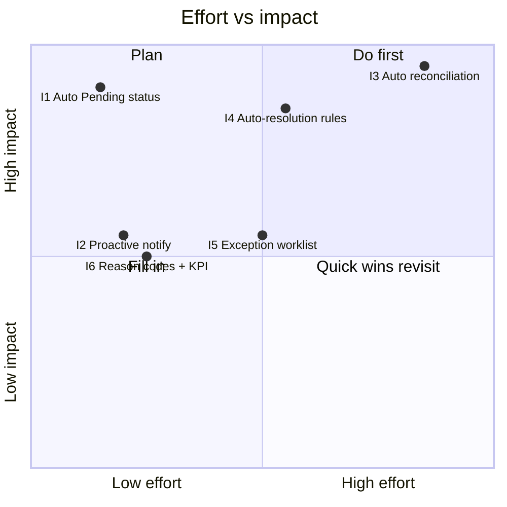

# Improvement Proposal & Business Case
## Exception handling for failed & pending instant transfers — NovaBank

> **Fictitious data, for demonstration purposes only.**

## 1. Objective

Move the exception-handling process from **manual, batched and reactive** to
**automated, near-real-time and proactive**, reducing resolution time, support
contacts and cost while improving customer experience.

## 2. Initiatives

| ID | Initiative | Description | Effort | Impact | Type |
|----|-----------|-------------|:------:|:------:|------|
| I1 | Automatic "Pending" status | Set a reliable terminal/penultimate status on rail timeout. | Low | High | Quick win |
| I2 | Proactive notification | Notify the customer as soon as a transfer becomes Pending. | Low | Medium | Quick win |
| I3 | Automated reconciliation | Scheduled match (every 15 min) against settlement files. | High | High | Strategic |
| I4 | Auto-resolution rules | Auto-complete/return/reject matched cases; auto-release after SLA. | Medium | High | Strategic |
| I5 | Exception worklist | Back-office list of true exceptions only, with full context. | Medium | Medium | Enabler |
| I6 | Reason codes & KPI feed | Mandatory closure reason codes; feed the KPI dashboard. | Low | Medium | Quick win |

## 3. Effort vs impact

## 4. Estimated business case (annualised)

**Assumptions** (fictional, illustrative):

- Transfers per year: **100,000** (extrapolated from 50,000 / 180 days).
- Exceptions requiring handling: **4,934 / year**.
- Fully-loaded cost per manual exception: **12.00**.
- Status-related support contacts: **22 / 1,000 transfers** at **6.00** each.

| Line | Baseline (AS-IS) | Target (TO-BE) | Annual difference |
|------|:----------------:|:--------------:|:-----------------:|
| Exceptions | 4,934 | 4,934 | – |
| Auto-resolved | 20% | 85% | +65 pp |
| Manually handled | 3,947 | 740 | −3,207 |
| Exception handling cost | 59,208 | 8,880 | **−50,328** |
| Support contacts | 2,200 | 1,320 | −880 |
| Support cost | 13,200 | 7,920 | **−5,280** |
| **Gross annual benefit** | – | – | **55,608** |
| Annual run cost | – | – | −6,000 |
| **Net annual benefit** | – | – | **49,608** |

| Investment | Value |
|------------|------:|
| One-time build (I1–I6) | 45,000 |
| **Payback period** | **≈ 11 months** |

## 5. Expected outcomes

| KPI | From | To |
|-----|:----:|:--:|
| Average resolution time | 5 days | 0.5 day |
| Auto-resolution rate | 20% | 85% |
| Status-contact rate | 22 / 1,000 | 13 / 1,000 |
| Cost per exception | 12.00 | 3.00 |

## 6. Roadmap

| Phase | Timeline | Initiatives |
|-------|----------|-------------|
| Phase 1 — Quick wins | 0–1 month | I1, I2, I6 |
| Phase 2 — Automation core | 1–3 months | I3, I4 |
| Phase 3 — Enablement & governance | 3–6 months | I5 + exception NFRs added to the requirements baseline |

## 7. Risks of the change

| Risk | Mitigation |
|------|------------|
| Auto-resolution releases funds incorrectly | Conservative SLA and dual-control for high-value cases |
| Reconciliation file mismatches | Idempotent processing and reconciliation audit logs |
| Customer confusion from new statuses | Clear status labels and proactive notification copy |
| Scope creep into other payment types | Time-box to instant transfers first |

## 8. Recommendation

Proceed with **Phase 1 quick wins immediately** (low effort, high visibility),
and approve the business case for **Phase 2 automation**, which delivers the
bulk of the benefit with a payback of roughly **11 months**.

> All figures, costs and timelines are fictional and for portfolio demonstration purposes only.
