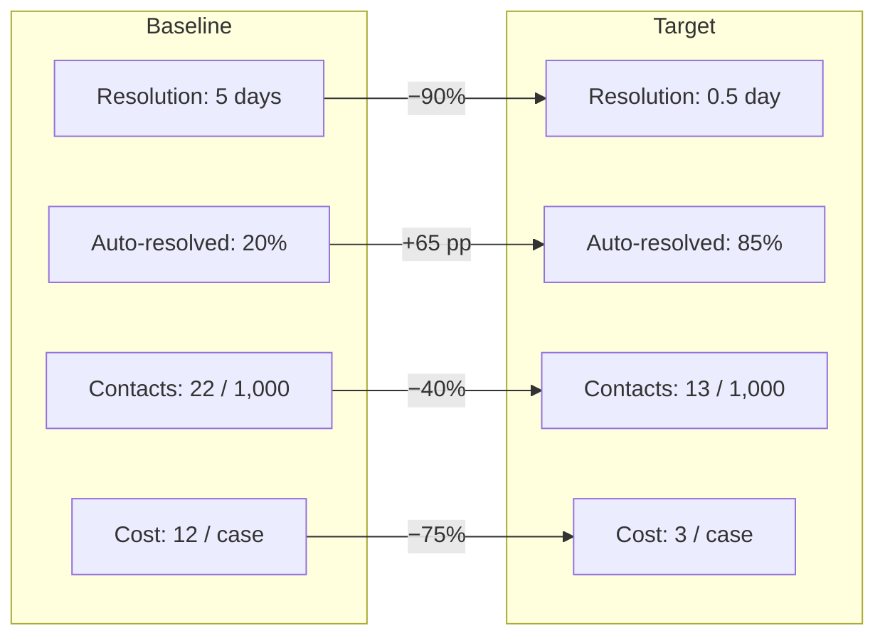

# KPIs — Baseline vs Target
## Exception handling for failed & pending instant transfers — NovaBank

> **Fictitious data, for demonstration purposes only.**

## 1. KPI framework

Each KPI has a clear definition, a baseline measured from the synthetic dataset
(Project 3), a target after the improvement, and an owner. Baselines are
fictional and illustrative.

| ID | KPI | Definition | Baseline (AS-IS) | Target (TO-BE) | Change | Owner |
|----|-----|-----------|:----------------:|:--------------:|:------:|-------|
| K1 | Average resolution time | Time from exception to terminal status | 5.0 days | 0.5 day | −90% | Payments Ops |
| K2 | Auto-resolution rate | % of exceptions resolved without an agent | 20% | ≥ 85% | +65 pp | IT / Payments Ops |
| K3 | Stale backlog | Pending transfers older than 5 days | 1,200 | ≤ 150 | −87% | Payments Ops |
| K4 | Status-contact rate | "Where is my transfer?" contacts per 1,000 transfers | 22 | 13 | −40% | Customer Support |
| K5 | Cost per exception | Fully-loaded handling cost per exception | 12.00 | 3.00 | −75% | Finance |
| K6 | Terminal-status within 24h | % exceptions reaching a terminal status within 24h | 30% | ≥ 90% | +60 pp | Payments Ops |
| K7 | First-contact resolution | % customer contacts resolved on first contact | 45% | ≥ 80% | +35 pp | Customer Support |
| K8 | CSAT for transfer issues | Customer satisfaction score for transfer problems | 2.9 / 5 | ≥ 4.3 / 5 | +48% | Product Owner |

## 2. Baseline context (from Project 3)

- **2,434** transfers in "Pending" over 180 days (~**4,934/year** extrapolated).
- **1,234** of them were "Rail timeout" and **1,200** "Awaiting reconciliation".
- No automated reconciliation or proactive notification today.
- Status-related support contacts estimated at **22 per 1,000 transfers**.

## 3. Targets summary

## 4. Measurement plan

| KPI | Data source | Frequency | Reporting |
|-----|-------------|-----------|-----------|
| K1, K3, K6 | Transactions/exception table | Daily | Operations dashboard |
| K2 | Reconciliation job logs | Daily | Operations dashboard |
| K4, K7 | CRM contact reasons | Weekly | Support dashboard |
| K5 | Finance cost model | Monthly | Monthly review |
| K8 | Customer survey | Monthly | Product review |

> All KPI values are fictional and for portfolio demonstration purposes only.
