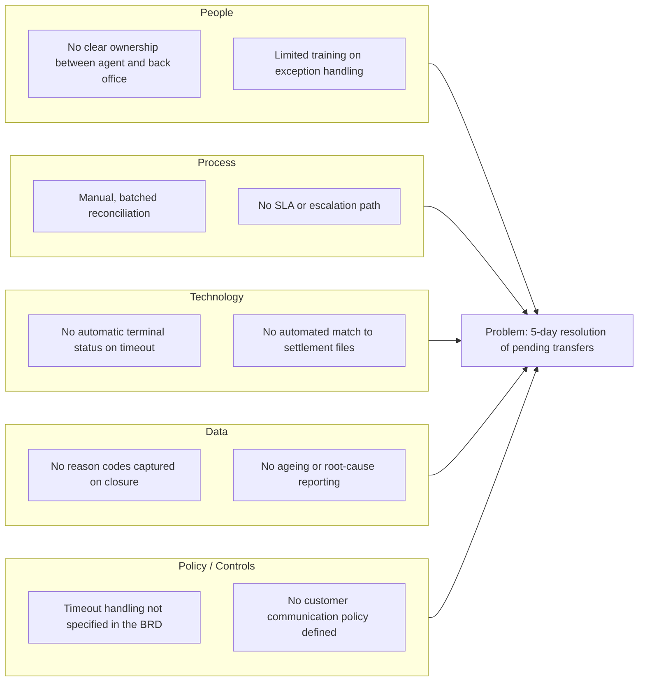

# Root Cause Analysis
## Long resolution time for failed & pending instant transfers — NovaBank

> **Fictitious data, for demonstration purposes only.**

## 1. Problem statement

Timed-out instant transfers take an average of **5 days** to reach a terminal
status, drive **22 support contacts per 1,000 transfers**, and are almost
always resolved manually. The problem is not a lack of effort by staff; it is
a system and process design gap.

## 2. Five Whys

| # | Why? | Answer |
|---|------|--------|
| 1 | Why do pending transfers take 5 days to resolve? | Because they are detected and resolved manually. |
| 2 | Why are they resolved manually? | Because the platform has no automatic terminal status and no automated reconciliation for timed-out transfers. |
| 3 | Why is there no automation for these cases? | Because the original release was built around the happy path, and timeouts were treated as an operational edge case. |
| 4 | Why was timeout handling treated as an edge case? | Because exception and failure flows were not explicitly captured in the requirements baseline. |
| 5 | Why were they not captured? | **Root cause:** the BRD covered functional success and failure messaging but omitted non-functional requirements for reconciliation, SLAs and automated exception handling. |

**Root cause (confirmed):** missing requirements and automation for the
exception-handling path, resulting in a manual, batched, reactive process.

## 3. Ishikawa (fishbone) diagram

## 4. Contributing factors and countermeasures

| Category | Contributing factor | Countermeasure | Initiative |
|----------|--------------------|----------------|------------|
| Technology | No automatic terminal status | Auto-set "Pending" then reconcile to a terminal state | I1, I4 |
| Technology | No automated reconciliation | Scheduled reconciliation job every 15 minutes | I3 |
| Process | Manual, batched resolution | Auto-resolve matched cases; exceptions-only worklist | I3, I4, I5 |
| Process | No SLA or escalation | Define SLA (2-hour auto-resolution) and escalation path | I3 |
| People | Unclear ownership | Single accountable owner for exception handling | I5 |
| Data | No reason codes / reporting | Mandatory reason codes and KPI dashboard feed | I6 |
| Policy | Missing NFRs in BRD | Add exception-handling NFRs to the requirements baseline | (backlog) |
| Policy | No communication policy | Proactive notification standard for pending transfers | I2 |

## 5. Link to evidence

- **Project 2 — DEF-001:** timeout transfers not transitioning to Pending.
- **Project 3 — Finding F4:** 2,434 transfers pending (1,234 rail timeouts).
- **Project 3 — Finding F5:** failures spread across limits, balance and beneficiary issues.

> All content is fictional and for portfolio demonstration purposes only.
