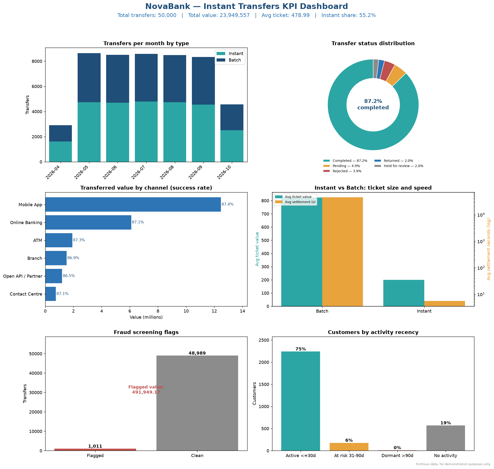

# Project 5 — KPI Dashboard (NovaBank)

> **Fictitious data, for demonstration purposes only.**
> NovaBank is an invented bank. All data, KPIs and charts in this project are
> synthetic and generated by script. No real data is used.

## Overview

This project turns the SQLite dataset from
[Project 3](../03-sql-transactions-analysis/) into an **executive KPI
dashboard** built with **pandas + matplotlib**. It exports six charts plus a
combined dashboard image and pairs them with a one-page executive summary.

## Contents

| Artefact | Path | Description |
|----------|------|-------------|
| Builder script | [scripts/build_dashboard.py](scripts/build_dashboard.py) | Reads the Project 3 database and exports the charts. |
| Charts | [charts/](charts/) | Six chart PNGs plus `dashboard.png`. |
| Executive summary | [docs/executive-summary.md](docs/executive-summary.md) | One-page summary with KPIs and recommendations. |

## Charts

| File | Chart |
|------|-------|
| `01_monthly_volume.png` | Transfers per month by type (instant vs batch) |
| `02_status_distribution.png` | Transfer status distribution (donut) |
| `03_channel_value.png` | Transferred value by channel with success rate |
| `04_instant_vs_batch.png` | Instant vs batch ticket size and settlement speed |
| `05_fraud_screening.png` | Fraud screening flags and flagged value |
| `06_customer_activity.png` | Customers by activity recency |
| `dashboard.png` | Combined 3x2 dashboard |



## How to run

The script reads `../03-sql-transactions-analysis/data/novabank.db`. If that
database does not exist, generate it first:

```powershell
# 1. Ensure the source database exists (Project 3)
python ..\03-sql-transactions-analysis\scripts\generate_data.py

# 2. Build the dashboard
python scripts/build_dashboard.py
```

Output is written to `charts/`.

## Highlight KPIs

- **50,000** transfers, **23,949,557** total value.
- Instant share **55.2%**, settling in **~5 s (100% < 10 s)**.
- Completion rate **87.2%**; **2,434** transfers stuck in "Pending".
- **2.0%** flagged suspicious; **19%** of customers never transacted.

> This project uses fictitious data, for demonstration purposes only.
